<!-- MANUFAI documentation: SVG descriptions and navigation, with original HTML video previews. -->

<a name="readme-image-001" href="#readme-image-001">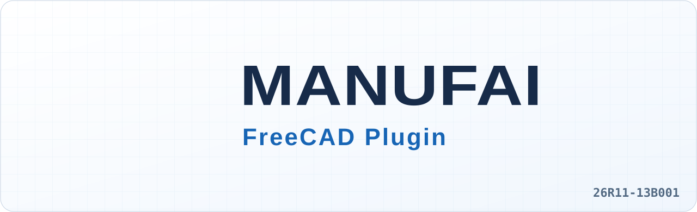</a>

<a name="readme-image-004" href="#readme-image-004">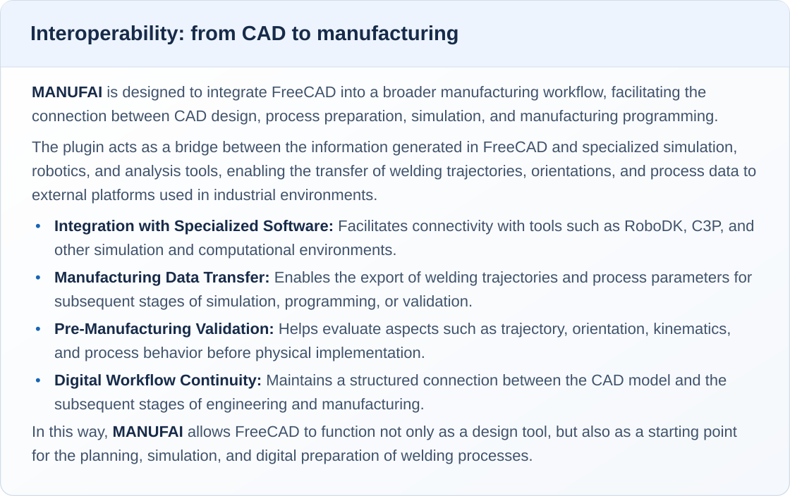</a>

 

<a name="readme-image-010" href="#readme-image-010">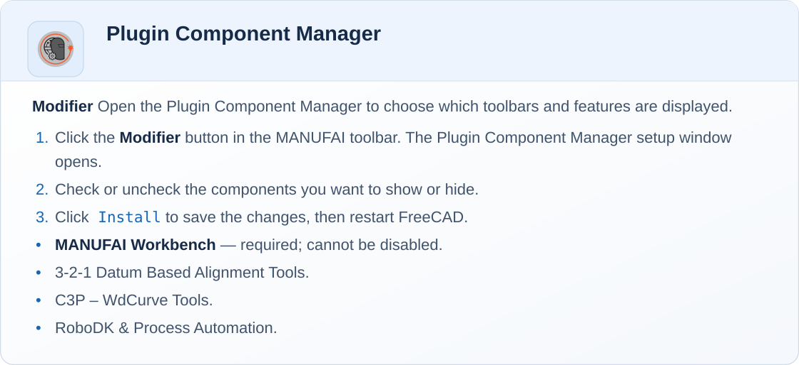</a>

 

 

 

 

 

 

 

<a name="readme-image-016" href="#readme-image-016">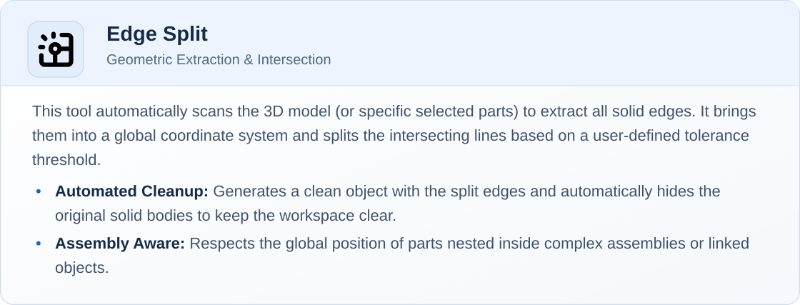</a>

 
<a href="https://youtu.be/54fv0JubX-k"><strong>FreeCAD Plugin - Edge Split</strong></a>

<a name="readme-image-017" href="#readme-image-017">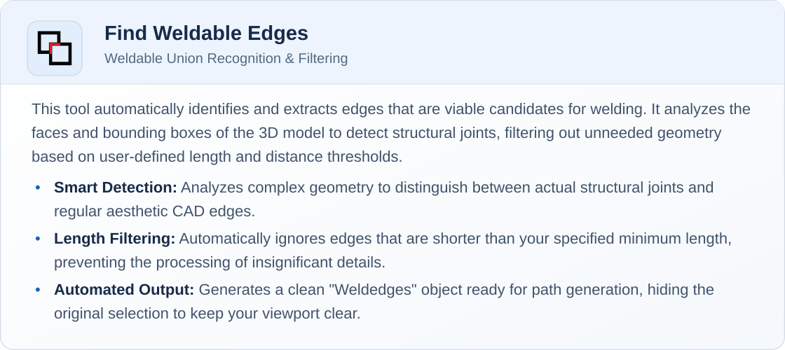</a>

 
<a href="https://youtu.be/j0QQFB-PkY4"><strong>FreeCAD Plugin - Find Weldable Edges</strong></a>

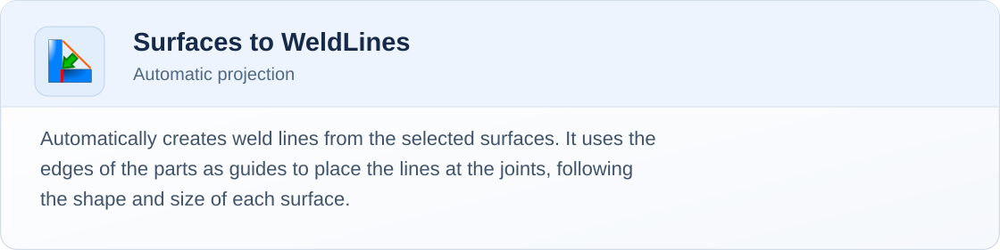

  
   
  <a href="https://www.youtube.com/watch?v=DtoMw-msI6I">
    <strong>FreeCAD Plugin - Surfaces to WeldLines</strong>
  </a>

<a name="readme-image-019" href="#readme-image-019">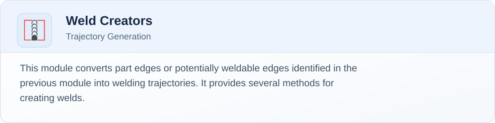</a>

<a name="readme-image-020" href="#readme-image-020">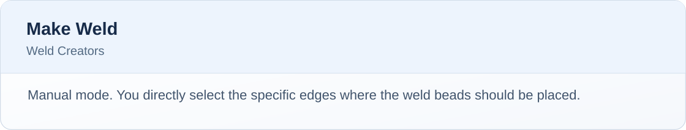</a>

 
<a href="https://youtu.be/k5xWTZYPGjs"><strong>FreeCAD Plugin - Make Weld</strong></a>

 
<a href="https://youtu.be/ScNLTLwiVGw"><strong>FreeCAD Plugin - Make Weld with All Edges</strong></a>

<a name="readme-image-022" href="#readme-image-022">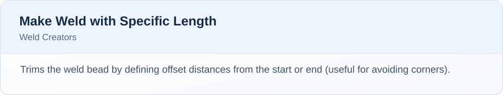</a>

 
<a href="https://youtu.be/iYEfRIMOwtM"><strong>FreeCAD Plugin - Make Weld with Specific Length</strong></a>

 
<a href="https://youtu.be/FOgGWKi9bns"><strong>FreeCAD Plugin - Make Weld with Chosen Points</strong></a>

 
<a href="https://youtu.be/buzmvsJmPw4"><strong>FreeCAD Plugin - Make Weld with Multiple Specific Lengths</strong></a>

 
<a href="https://youtu.be/X79-NE6YMWs"><strong>FreeCAD Plugin - By Bead Quantity</strong></a>

<a name="readme-image-026" href="#readme-image-026">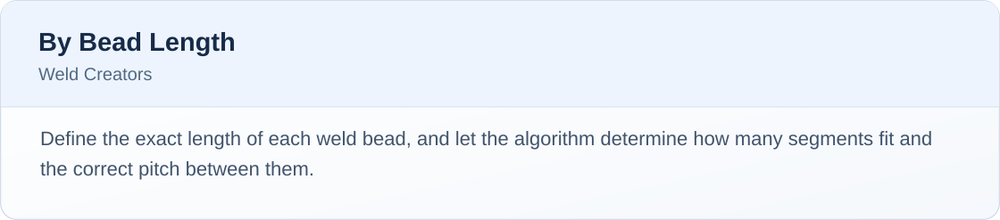</a>

 
<a href="https://youtu.be/ojkG1JGyR8E"><strong>FreeCAD Plugin - By Bead Length</strong></a>

 
<a href="https://youtu.be/ghHJnPubcGo"><strong>FreeCAD Plugin - By Bead Pitch</strong></a>

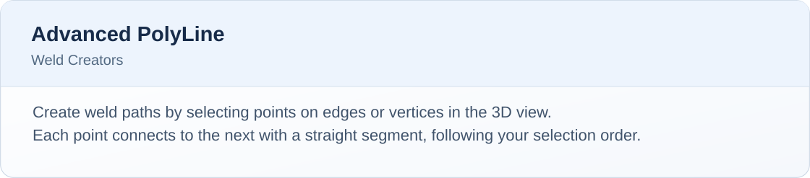

  
   
  <a href="https://www.youtube.com/watch?v=pps7-EeCIhw">
    <strong>FreeCAD Plugin - Advanced PolyLine</strong>
  </a>

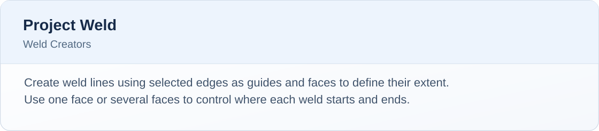

  
   
  <a href="https://www.youtube.com/watch?v=xUlKnfjCe-s">
    <strong>FreeCAD Plugin - Project Weld</strong>
  </a>

<a name="readme-image-029" href="#readme-image-029">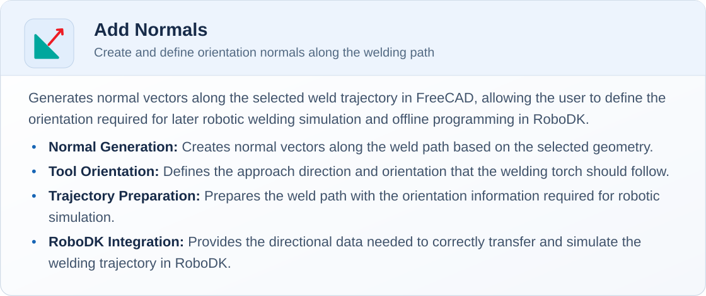</a>

 
<a href="https://youtu.be/lEqOmR37LBs"><strong>FreeCAD Plugin - Add Normals</strong></a>

 
<a href="https://youtu.be/HeBjlSux3yk"><strong>FreeCAD Plugin - Surface Weld</strong></a>

 
<a href="https://youtu.be/wKNppYpSfjM"><strong>FreeCAD Plugin - Weld Loader</strong></a>

<a name="readme-image-036" href="#readme-image-036">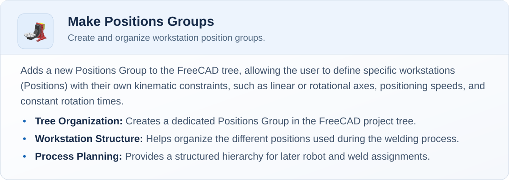</a>

 
<a href="https://youtu.be/OAjbMn-tApA"><strong>FreeCAD Plugin - Make Positions Groups</strong></a>

<a name="readme-image-037" href="#readme-image-037">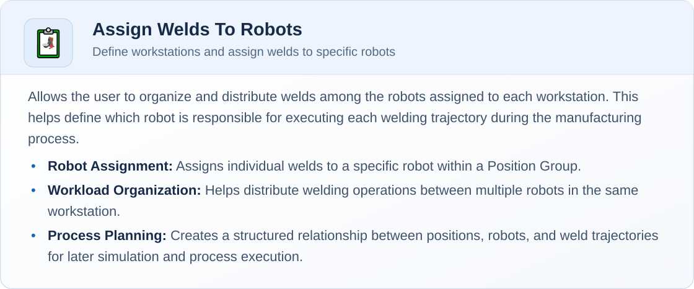</a>

 
<a href="https://youtu.be/pOXftU6GnWs"><strong>FreeCAD Plugin - Assign Welds To Robots</strong></a>

 
<a href="https://youtu.be/YpmVaKtMTJo"><strong>FreeCAD Plugin - SubAssembly</strong></a>

 
<a href="https://youtu.be/fhsHkXg7iRw"><strong>FreeCAD Plugin - Assign Positions</strong></a>

 
<a href="https://youtu.be/mTTKCpFWVYk"><strong>FreeCAD Plugin - Move SubAssembly</strong></a>

 
<a href="https://youtu.be/qzIUtdA1wy0"><strong>FreeCAD Plugin - Move Welds</strong></a>

 
<a href="https://youtu.be/I0hxfyDhnyU"><strong>FreeCAD Plugin - Weld Length Report</strong></a>

<a name="readme-image-049" href="#readme-image-049">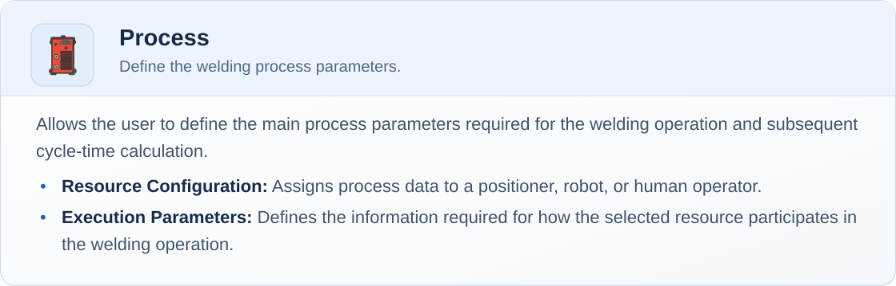</a>

 
<a href="https://youtu.be/J3FsFntzbZI"><strong>FreeCAD Plugin - Process</strong></a>

 
<a href="https://youtu.be/1zkwhSOLzEg"><strong>FreeCAD Plugin - Assign Process</strong></a>

 
<a href="https://youtu.be/efYxr2li1Y0"><strong>FreeCAD Plugin - Welding Parameters</strong></a>

 
<a href="https://youtu.be/nIkySTHVPmg"><strong>FreeCAD Plugin - Assign Welding Parameters</strong></a>

 
<a href="https://youtu.be/YfequjjJOHg"><strong>FreeCAD Plugin - Cycle Time</strong></a>

 
<a href="https://youtu.be/gqeM4_K-ECU"><strong>FreeCAD Plugin - Create Materials</strong></a>

<a name="readme-image-059" href="#readme-image-059">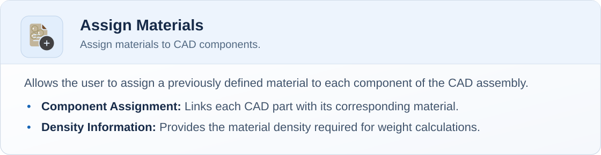</a>

 
<a href="https://youtu.be/p5DxkcvCbJ0"><strong>FreeCAD Plugin - Assign Materials</strong></a>

 
<a href="https://youtu.be/TSO2ZFOpXFQ"><strong>FreeCAD Plugin - Weight of Welding and Welded Part</strong></a>

<a name="readme-image-064" href="#readme-image-064">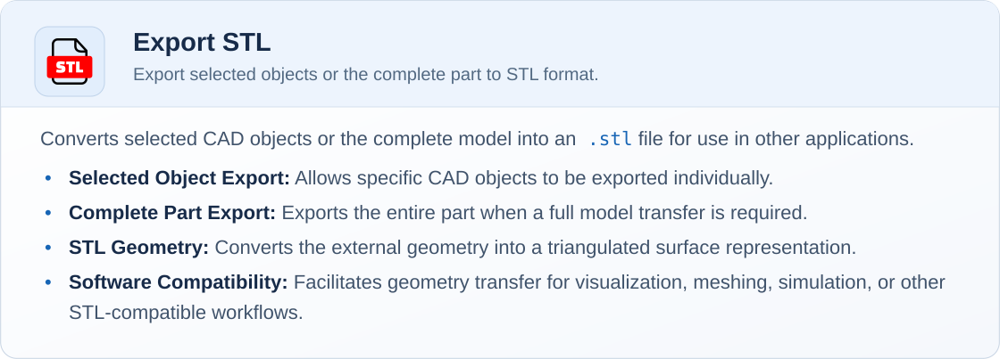</a>

 
<a href="https://youtu.be/8J90-dEdBuw"><strong>FreeCAD Plugin - Export STL</strong></a>

<a name="readme-image-066" href="#readme-image-066">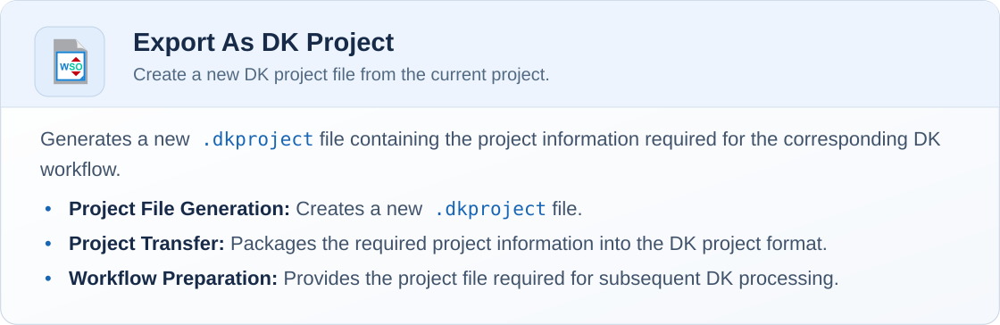</a>

 
<a href="https://youtu.be/tFdOI0CLJ2E"><strong>FreeCAD Plugin - Export As .DK Project</strong></a>

 
<a href="https://youtu.be/PHD1q_jOWfI"><strong>FreeCAD Plugin - Visualizer sequence</strong></a>

<a name="readme-image-069" href="#readme-image-069">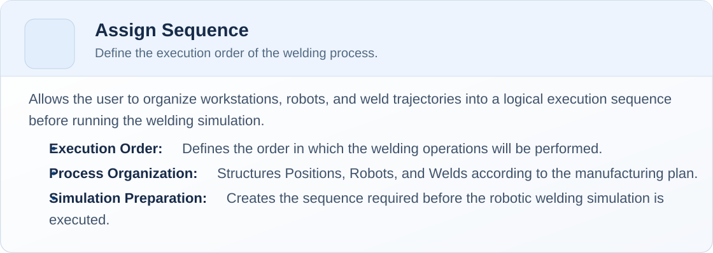</a>

 
<a href="https://youtu.be/sbbIHfgqX2g"><strong>FreeCAD Plugin - Assign Sequence</strong></a>

<a name="readme-image-071" href="#readme-image-071">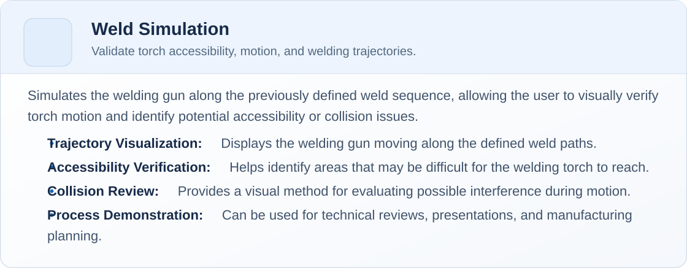</a>

 
<a href="https://youtu.be/IG-jzgcbnaU"><strong>FreeCAD Plugin - Weld Simulation</strong></a>

 
<a href="https://youtu.be/WYtFumW3uMA"><strong>FreeCAD Plugin - Show Weld Sphere</strong></a>

<a name="readme-image-075" href="#readme-image-075">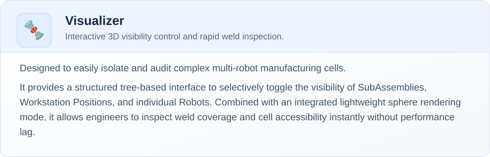</a>

 
<a href="https://youtu.be/Trsfr1fTupg"><strong>FreeCAD Plugin - Visualizer</strong></a>

 

 
<a href="https://youtu.be/98fj0JjP6xo"><strong>FreeCAD Plugin - Toggle Visibility Recursive</strong></a>

<a name="readme-image-080" href="#readme-image-080">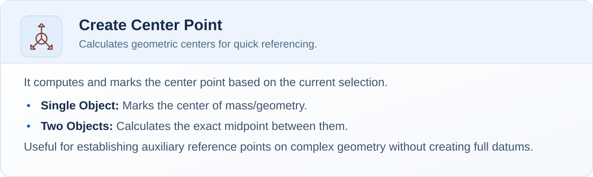</a>

 
<a href="https://youtu.be/9Kda5vfYem0"><strong>FreeCAD Plugin - Create Center Point</strong></a>

<a name="readme-image-082" href="#readme-image-082">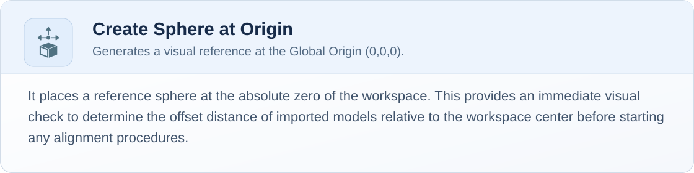</a>

 
<a href="https://youtu.be/lA9C68IScxQ"><strong>FreeCAD Plugin - Create Sphere at Origin</strong></a>

<a name="readme-image-085" href="#readme-image-085">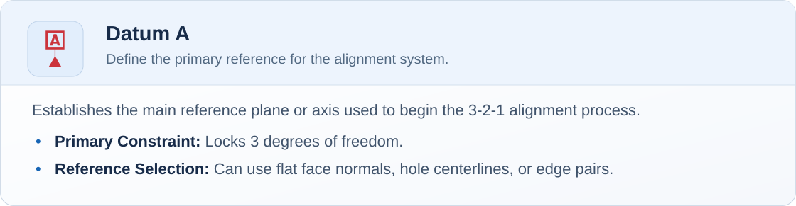</a>

<a name="readme-image-086" href="#readme-image-086">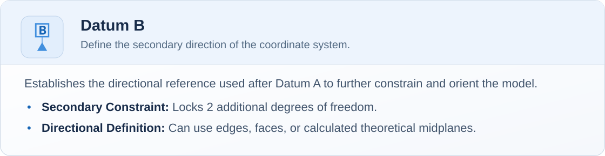</a>

<a name="readme-image-087" href="#readme-image-087">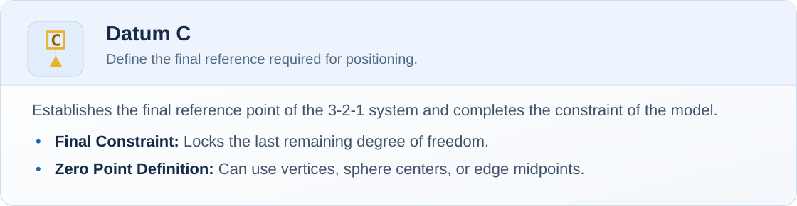</a>

<a name="readme-image-088" href="#readme-image-088">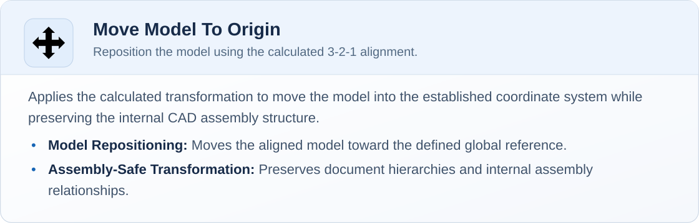</a>

 
<a href="https://youtu.be/Zr0ybqXDSgg"><strong>FreeCAD Plugin - 3-2-1 Datum Based Alignment</strong></a>

<a name="readme-image-091" href="#readme-image-091">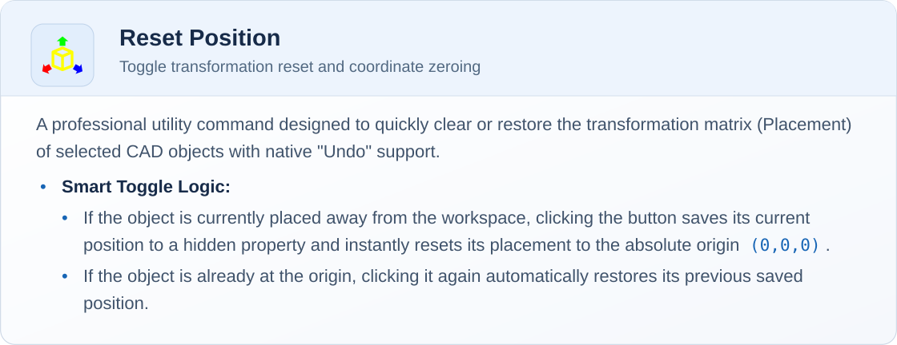</a>

 
<a href="https://youtu.be/CXzQ7datvRk"><strong>FreeCAD Plugin - Reset Position</strong></a>

<a name="readme-image-093" href="#readme-image-093">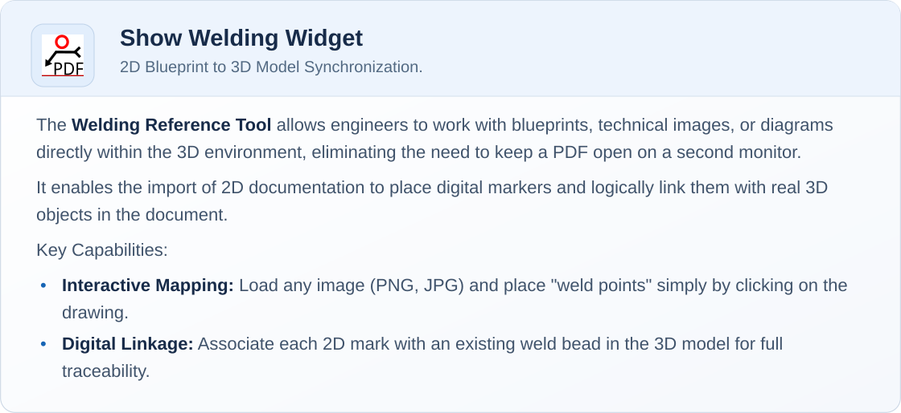</a>

 
<a href="https://youtu.be/SjJHcsazPro"><strong>FreeCAD Plugin - Show Welding Widget</strong></a>

 
<a href="https://youtu.be/0TlnWFqXXWM"><strong>FreeCAD Plugin - Launch Find Data Panel</strong></a>

 
<a href="https://youtu.be/KZhHsQ0q4Go"><strong>FreeCAD Plugin - Focus Object</strong></a>

<a name="readme-image-099" href="#readme-image-099">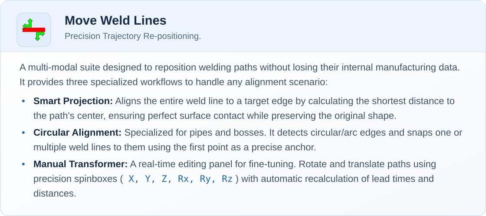</a>

 
<a href="https://youtu.be/I7i4gXoQ7sU"><strong>FreeCAD Plugin - Move Weld Lines</strong></a>

 
<a href="https://youtu.be/PjOlYZdEWsc"><strong>FreeCAD Plugin - Discretize</strong></a>

 

 
<a href="https://youtu.be/ulF9SZYRMbs"><strong>FreeCAD Plugin - Line Weld Table</strong></a>

<a name="readme-image-105" href="#readme-image-105">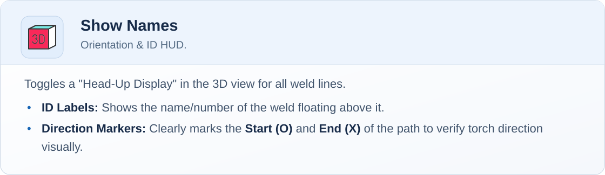</a>

 
<a href="https://youtu.be/rHTBzO_KlUM"><strong>FreeCAD Plugin - Show Names</strong></a>

 
<a href="https://youtu.be/OYs8zfXLmLg"><strong>FreeCAD Plugin - Selection Mode (X-Ray &amp; Filter)</strong></a>

 

 
<a href="https://youtu.be/OEVVUK7duXI"><strong>FreeCAD Plugin - Export To .rdk Project</strong></a>

 
<a href="https://youtu.be/UfwyzfO2fFI"><strong>FreeCAD Plugin - Robotic Cell Modeling for automatic transfer of weld data</strong></a>

 
<a href="https://youtu.be/_DmwPQABFhU"><strong>Weld Path to Robot Program - FreeCAD Plugin Demo</strong></a>

 
<a href="https://youtu.be/guC-Ew76XLk"><strong>FreeCAD Plugin - Export to RoboDK</strong></a>

<strong>Export Full</strong> 

<strong>Export Selected</strong> 

<a name="readme-image-113" href="#readme-image-113">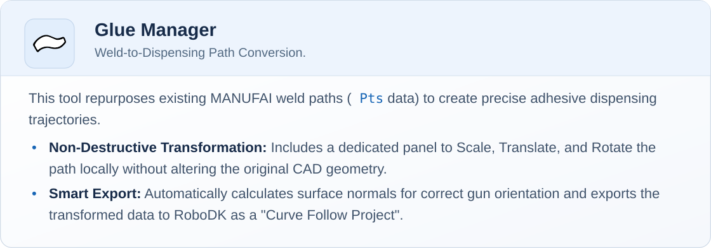</a>

 
<a href="https://youtu.be/tAGyyp9iRvI"><strong>FreeCAD Plugin - Glue Manager</strong></a>

 
<a href="https://youtu.be/tdOwb-ST3sI"><strong>FreeCAD Plugin - Drilling Manager</strong></a>

 

