<!-- MANUFAI documentation: SVG descriptions and navigation, with original HTML video previews. -->

<!-- SVG: MANUFAI FreeCAD Plugin -->

<!-- SVG: Welding engineering & simulation -->
<a name="readme-image-002" href="#readme-image-002">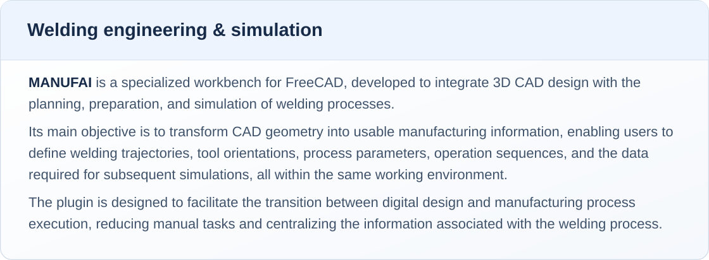</a>

<!-- SVG: Key capabilities -->
<a name="readme-image-003" href="#readme-image-003">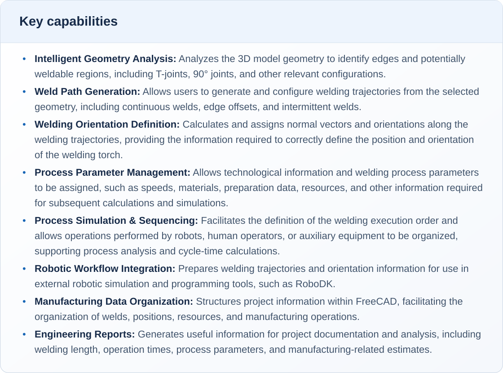</a>

<!-- SVG: Interoperability: from CAD to manufacturing -->

<!-- SVG: Download & installation -->
<a name="readme-image-006" href="#readme-image-006">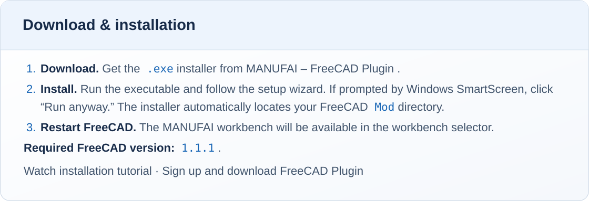</a>

<!-- DOWNLOAD: Download plugin -->
 
<!-- VIDEO: Installation tutorial -->

<!-- SVG: Activation -->
<a name="readme-image-008" href="#readme-image-008">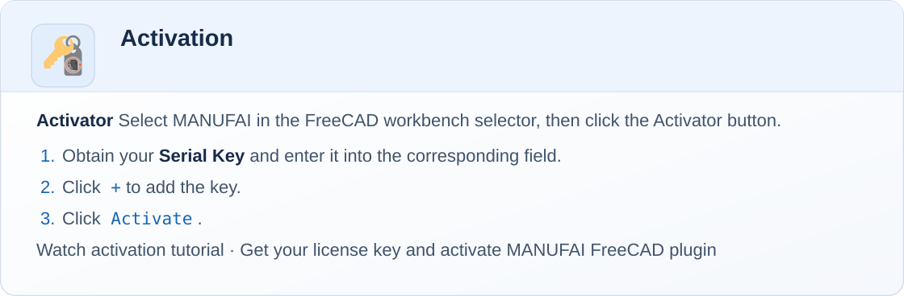</a>

<!-- VIDEO: Activation tutorial -->

<!-- SVG: Quick tip -->
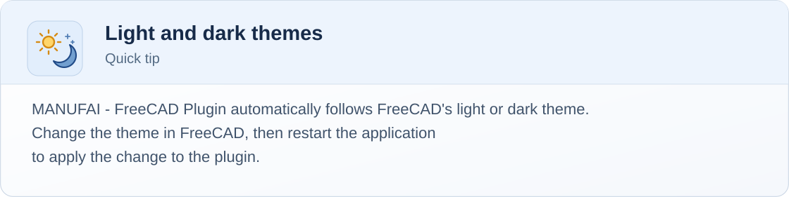

<!-- SVG: Plugin Component Manager -->

<!-- SVG: Repository structure & test resources -->
<a name="readme-image-012" href="#readme-image-012">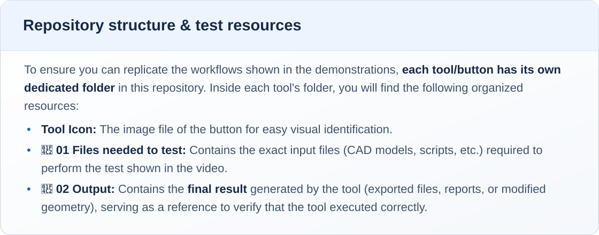</a>

<!-- INDEX GROUP: MANUFAI Workbench -->

<!-- INDEX GROUP: Make Weld Trajectories -->

<!-- INDEX BUTTON: Edge Split -->

<!-- INDEX BUTTON: Find Weldable Edges -->

<!-- INDEX BUTTON: Weld Creators -->

<!-- INDEX BUTTON: Add Normals -->

 
<!-- INDEX BUTTON: Surface Weld -->

<!-- INDEX BUTTON: Weld Loader -->

<!-- INDEX GROUP: Positions -->

<!-- INDEX BUTTON: Make Positions Groups -->

<!-- INDEX BUTTON: Assign Welds To Robots -->

<!-- INDEX BUTTON: SubAssembly -->

<!-- INDEX BUTTON: Assign Positions -->

 
<!-- INDEX BUTTON: Move SubAssembly -->

<!-- INDEX BUTTON: Move Welds -->

<!-- INDEX GROUP: Length -->

<!-- INDEX BUTTON: Weld Length Report -->

<!-- INDEX GROUP: Cycle Time -->

<!-- INDEX BUTTON: Process -->

<!-- INDEX BUTTON: Assign Process -->

<!-- INDEX BUTTON: Welding Parameters -->

<!-- INDEX BUTTON: Assign Welding Parameters -->

 
<!-- INDEX BUTTON: Cycle Time -->

<!-- INDEX GROUP: Weight -->

<!-- INDEX BUTTON: Create Materials -->

<!-- INDEX BUTTON: Assign Materials -->

<!-- INDEX BUTTON: Weight of Welding and Welded Part -->

<!-- INDEX GROUP: Welding Sequence AI Advisor -->

<!-- INDEX BUTTON: Export STL -->

<!-- INDEX BUTTON: Export As DK Project -->

<!-- INDEX GROUP: Sequence and Process Visualization -->

<!-- INDEX BUTTON: Assign Sequence -->

<!-- INDEX BUTTON: Weld Simulation -->

<!-- INDEX BUTTON: Show Weld Sphere -->

<!-- INDEX BUTTON: Visualizer -->

<!-- INDEX GROUP: 3-2-1 Datum Based Alignment & Tools -->

<!-- INDEX BUTTON: Toggle Visibility Recursive -->

<!-- INDEX BUTTON: Create Center Point -->

<!-- INDEX BUTTON: Create Sphere at Origin -->

<!-- INDEX BUTTON: Datum A -->

 
<!-- INDEX BUTTON: Datum B -->

<!-- INDEX BUTTON: Datum C -->

<!-- INDEX BUTTON: 3-2-1 Datum-Based Alignment -->

<!-- INDEX BUTTON: Move Model To Origin -->

 
<!-- INDEX BUTTON: Reset Position -->

<!-- INDEX BUTTON: Show Welding Widget -->

<!-- INDEX BUTTON: Launch Find Data Panel -->

<!-- INDEX BUTTON: Focus Object -->

 
<!-- INDEX BUTTON: Move Weld Lines -->

<!-- INDEX BUTTON: Discretize -->

<!-- INDEX GROUP: C3P – WdCurve Tools -->

<!-- INDEX BUTTON: Line Weld Table -->

<!-- INDEX BUTTON: Show Names -->

<!-- INDEX BUTTON: Selection Mode (X-Ray & Filter) -->

<!-- INDEX GROUP: RoboDK & Process Automation -->

<!-- INDEX BUTTON: Export To .rdk Project -->

<!-- INDEX BUTTON: Export Full -->

<!-- INDEX BUTTON: Glue Manager -->

<!-- INDEX BUTTON: Drilling Manager -->

<!-- SECTION: MANUFAI Workbench -->
<!-- SVG: MANUFAI Workbench -->

<!-- SECTION: Make Weld Trajectories -->
<!-- SVG: Make Weld Trajectories -->

<!-- ========== BUTTON: Edge Split ========== -->

<!-- SVG: Edge Split -->

<!-- VIDEO: FreeCAD Plugin - Edge Split -->

 
<a href="https://youtu.be/54fv0JubX-k"><strong>FreeCAD Plugin - Edge Split</strong></a>

<!-- MATERIALS: Edge Split -->

<!-- NAVIGATION: Back to top -->
 &nbsp; 
<!-- MATERIALS BUTTON: Edge Split -->
 &nbsp; 
<!-- NAVIGATION: Back to tool index -->

<!-- ========== BUTTON: Find Weldable Edges ========== -->

<!-- SVG: Find Weldable Edges -->

<!-- VIDEO: FreeCAD Plugin - Find Weldable Edges -->

 
<a href="https://youtu.be/j0QQFB-PkY4"><strong>FreeCAD Plugin - Find Weldable Edges</strong></a>

<!-- MATERIALS: Find Weldable Edges -->

<!-- NAVIGATION: Back to top -->
 &nbsp; 
<!-- MATERIALS BUTTON: Find Weldable Edges -->
 &nbsp; 
<!-- NAVIGATION: Back to tool index -->

<!-- SVG: Quick tip -->
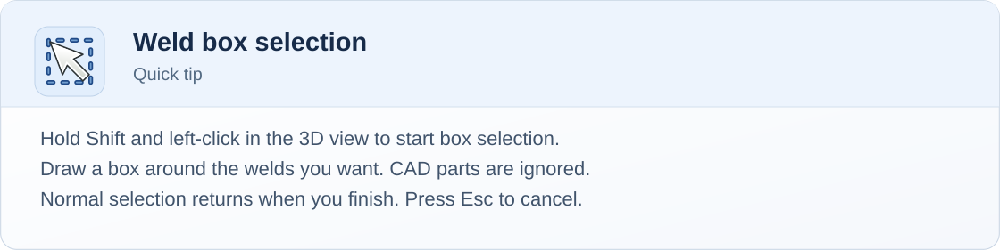

<!-- ========== BUTTON: Surfaces to WeldLines ========== -->
<!-- SVG: Surfaces to WeldLines -->

<!-- VIDEO: FreeCAD Plugin - Surfaces to WeldLines -->

  
   
  <a href="https://www.youtube.com/watch?v=DtoMw-msI6I">
    <strong>FreeCAD Plugin - Surfaces to WeldLines</strong>
  </a>

<!-- MATERIALS: Surfaces to WeldLines -->

<!-- NAVIGATION: Back to top -->
 &nbsp; 
<!-- MATERIALS BUTTON: Surfaces to WeldLines -->
 &nbsp; 
<!-- NAVIGATION: Back to tool index -->

<!-- ========== BUTTON: Weld Creators ========== -->

<!-- SVG: Weld Creators -->

<!-- MATERIALS: Weld Creators -->

<!-- NAVIGATION: Back to top -->
 &nbsp; 
<!-- MATERIALS BUTTON: Weld Creators -->
 &nbsp; 
<!-- NAVIGATION: Back to tool index -->

<!-- ========== BUTTON: Weld Creators — Make Weld ========== -->

<!-- SVG: Weld Creators — Make Weld -->

<!-- VIDEO: FreeCAD Plugin - Make Weld -->

 
<a href="https://youtu.be/k5xWTZYPGjs"><strong>FreeCAD Plugin - Make Weld</strong></a>

<!-- MATERIALS: Make Weld -->

<!-- NAVIGATION: Back to top -->
 &nbsp; 
<!-- MATERIALS BUTTON: Make Weld -->
 &nbsp; 
<!-- NAVIGATION: Back to tool index -->

<!-- ========== BUTTON: Weld Creators — Make Weld with All Edges ========== -->

<!-- SVG: Weld Creators — Make Weld with All Edges -->
<a name="readme-image-021" href="#readme-image-021">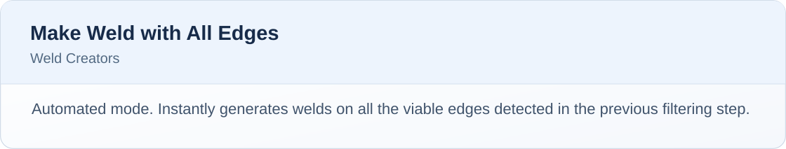</a>

<!-- VIDEO: FreeCAD Plugin - Make Weld with All Edges -->

 
<a href="https://youtu.be/ScNLTLwiVGw"><strong>FreeCAD Plugin - Make Weld with All Edges</strong></a>

<!-- MATERIALS: Make Weld with All Edges -->

<!-- NAVIGATION: Back to top -->
 &nbsp; 
<!-- MATERIALS BUTTON: Make Weld with All Edges -->
 &nbsp; 
<!-- NAVIGATION: Back to tool index -->

<!-- ========== BUTTON: Weld Creators — Make Weld with Specific Length ========== -->

<!-- SVG: Weld Creators — Make Weld with Specific Length -->

<!-- VIDEO: FreeCAD Plugin - Make Weld with Specific Length -->

 
<a href="https://youtu.be/iYEfRIMOwtM"><strong>FreeCAD Plugin - Make Weld with Specific Length</strong></a>

<!-- MATERIALS: Make Weld with Specific Length -->

<!-- NAVIGATION: Back to top -->
 &nbsp; 
<!-- MATERIALS BUTTON: Make Weld with Specific Length -->
 &nbsp; 
<!-- NAVIGATION: Back to tool index -->

<!-- ========== BUTTON: Weld Creators — Make Weld with Chosen Points ========== -->

<!-- SVG: Weld Creators — Make Weld with Chosen Points -->
<a name="readme-image-023" href="#readme-image-023">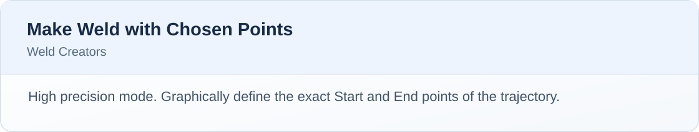</a>

<!-- VIDEO: FreeCAD Plugin - Make Weld with Chosen Points -->

 
<a href="https://youtu.be/FOgGWKi9bns"><strong>FreeCAD Plugin - Make Weld with Chosen Points</strong></a>

<!-- MATERIALS: Make Weld with Chosen Points -->

<!-- NAVIGATION: Back to top -->
 &nbsp; 
<!-- MATERIALS BUTTON: Make Weld with Chosen Points -->
 &nbsp; 
<!-- NAVIGATION: Back to tool index -->

<!-- ========== BUTTON: Weld Creators — Make Weld with Multiple Specific Lengths ========== -->

<!-- SVG: Weld Creators — Make Weld with Multiple Specific Lengths -->

<!-- VIDEO: FreeCAD Plugin - Make Weld with Multiple Specific Lengths -->

 
<a href="https://youtu.be/buzmvsJmPw4"><strong>FreeCAD Plugin - Make Weld with Multiple Specific Lengths</strong></a>

<!-- MATERIALS: Make Weld with Multiple Specific Lengths -->

<!-- NAVIGATION: Back to top -->
 &nbsp; 
<!-- MATERIALS BUTTON: Make Weld with Multiple Specific Lengths -->
 &nbsp; 
<!-- NAVIGATION: Back to tool index -->

<!-- ========== BUTTON: Weld Creators — By Bead Quantity ========== -->

<!-- SVG: Weld Creators — By Bead Quantity -->
<a name="readme-image-025" href="#readme-image-025">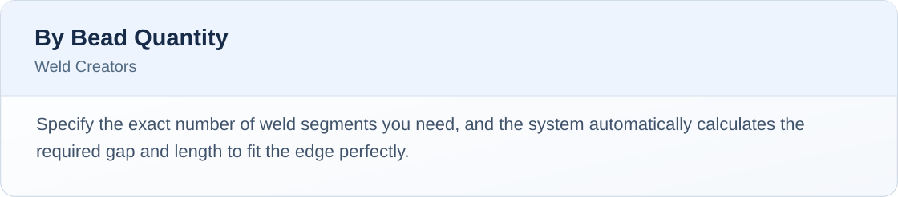</a>

<!-- VIDEO: FreeCAD Plugin - By Bead Quantity -->

 
<a href="https://youtu.be/X79-NE6YMWs"><strong>FreeCAD Plugin - By Bead Quantity</strong></a>

<!-- MATERIALS: By Bead Quantity -->

<!-- NAVIGATION: Back to top -->
 &nbsp; 
<!-- MATERIALS BUTTON: By Bead Quantity -->
 &nbsp; 
<!-- NAVIGATION: Back to tool index -->

<!-- ========== BUTTON: Weld Creators — By Bead Length ========== -->

<!-- SVG: Weld Creators — By Bead Length -->

<!-- VIDEO: FreeCAD Plugin - By Bead Length -->

 
<a href="https://youtu.be/ojkG1JGyR8E"><strong>FreeCAD Plugin - By Bead Length</strong></a>

<!-- MATERIALS: By Bead Length -->

<!-- NAVIGATION: Back to top -->
 &nbsp; 
<!-- MATERIALS BUTTON: By Bead Length -->
 &nbsp; 
<!-- NAVIGATION: Back to tool index -->

<!-- ========== BUTTON: Weld Creators — By Bead Pitch ========== -->

<!-- SVG: Weld Creators — By Bead Pitch -->
<a name="readme-image-027" href="#readme-image-027">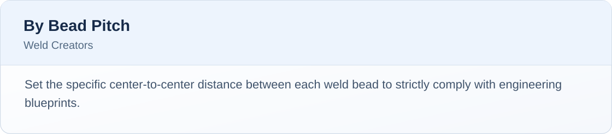</a>

<!-- VIDEO: FreeCAD Plugin - By Bead Pitch -->

 
<a href="https://youtu.be/ghHJnPubcGo"><strong>FreeCAD Plugin - By Bead Pitch</strong></a>

<!-- MATERIALS: By Bead Pitch -->

<!-- NAVIGATION: Back to top -->
 &nbsp; 
<!-- MATERIALS BUTTON: By Bead Pitch -->
 &nbsp; 
<!-- NAVIGATION: Back to tool index -->

<!-- ========== BUTTON: Weld Creators — Advanced PolyLine ========== -->

<!-- SVG: Weld Creators — Advanced PolyLine -->

<!-- VIDEO: FreeCAD Plugin - Advanced PolyLine -->

  
   
  <a href="https://www.youtube.com/watch?v=pps7-EeCIhw">
    <strong>FreeCAD Plugin - Advanced PolyLine</strong>
  </a>

<!-- MATERIALS: Advanced PolyLine -->

<!-- NAVIGATION: Back to top -->
 &nbsp; 
<!-- MATERIALS BUTTON: Advanced PolyLine -->
 &nbsp; 
<!-- NAVIGATION: Back to tool index -->

<!-- ========== BUTTON: Weld Creators — Project Weld ========== -->

<!-- SVG: Weld Creators — Project Weld -->

<!-- VIDEO: FreeCAD Plugin - Project Weld -->

  
   
  <a href="https://www.youtube.com/watch?v=xUlKnfjCe-s">
    <strong>FreeCAD Plugin - Project Weld</strong>
  </a>

<!-- MATERIALS: Project Weld -->

<!-- NAVIGATION: Back to top -->
 &nbsp; 
<!-- MATERIALS BUTTON: Project Weld -->
 &nbsp; 
<!-- NAVIGATION: Back to tool index -->

<!-- ========== BUTTON: Add Normals ========== -->

<!-- SVG: Add Normals -->

<!-- VIDEO: FreeCAD Plugin - Add Normals -->

 
<a href="https://youtu.be/lEqOmR37LBs"><strong>FreeCAD Plugin - Add Normals</strong></a>

<!-- MATERIALS: Add Normals -->

<!-- NAVIGATION: Back to top -->
 &nbsp; 
<!-- MATERIALS BUTTON: Add Normals -->
 &nbsp; 
<!-- NAVIGATION: Back to tool index -->

<!-- ========== BUTTON: Surface Weld ========== -->

<!-- SVG: Surface Weld -->
<a name="readme-image-031" href="#readme-image-031">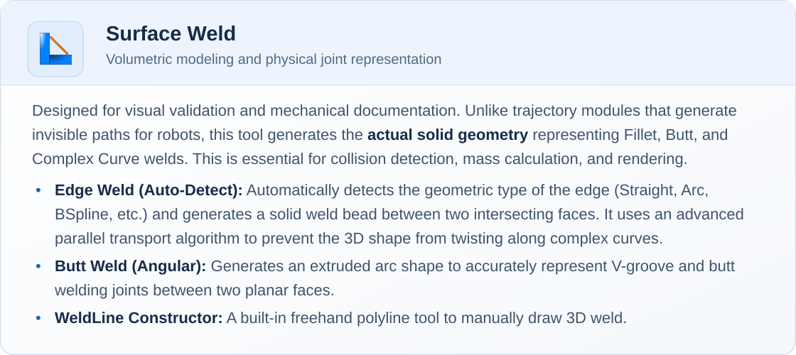</a>

<!-- VIDEO: FreeCAD Plugin - Surface Weld -->

 
<a href="https://youtu.be/HeBjlSux3yk"><strong>FreeCAD Plugin - Surface Weld</strong></a>

<!-- MATERIALS: Surface Weld -->

<!-- NAVIGATION: Back to top -->
 &nbsp; 
<!-- MATERIALS BUTTON: Surface Weld -->
 &nbsp; 
<!-- NAVIGATION: Back to tool index -->

<!-- ========== BUTTON: Weld Loader ========== -->

<!-- SVG: Weld Loader -->
<a name="readme-image-033" href="#readme-image-033">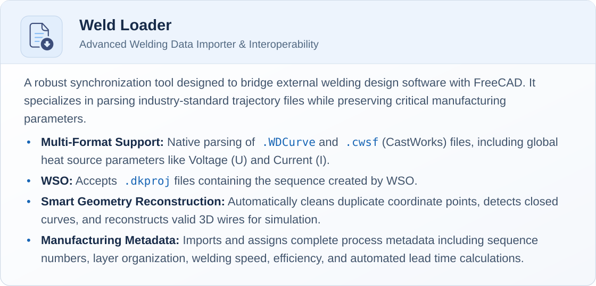</a>

<!-- VIDEO: FreeCAD Plugin - Weld Loader -->

 
<a href="https://youtu.be/wKNppYpSfjM"><strong>FreeCAD Plugin - Weld Loader</strong></a>

<!-- MATERIALS: Weld Loader -->

<!-- NAVIGATION: Back to top -->
 &nbsp; 
<!-- MATERIALS BUTTON: Weld Loader -->
 &nbsp; 
<!-- NAVIGATION: Back to tool index -->

<!-- SECTION: Positions -->
<!-- SVG: Positions -->

<!-- ========== BUTTON: Make Positions Groups ========== -->

<!-- SVG: Make Positions Groups -->

<!-- VIDEO: FreeCAD Plugin - Make Positions Groups -->

 
<a href="https://youtu.be/OAjbMn-tApA"><strong>FreeCAD Plugin - Make Positions Groups</strong></a>

<!-- MATERIALS: Make Positions Groups -->

<!-- NAVIGATION: Back to top -->
 &nbsp; 
<!-- MATERIALS BUTTON: Make Positions Groups -->
 &nbsp; 
<!-- NAVIGATION: Back to tool index -->

<!-- ========== BUTTON: Assign Welds To Robots ========== -->

<!-- SVG: Assign Welds To Robots -->

<!-- VIDEO: FreeCAD Plugin - Assign Welds To Robots -->

 
<a href="https://youtu.be/pOXftU6GnWs"><strong>FreeCAD Plugin - Assign Welds To Robots</strong></a>

<!-- MATERIALS: Assign Welds To Robots -->

<!-- NAVIGATION: Back to top -->
 &nbsp; 
<!-- MATERIALS BUTTON: Assign Welds To Robots -->
 &nbsp; 
<!-- NAVIGATION: Back to tool index -->

<!-- ========== BUTTON: SubAssembly ========== -->

<!-- SVG: SubAssembly -->
<a name="readme-image-039" href="#readme-image-039">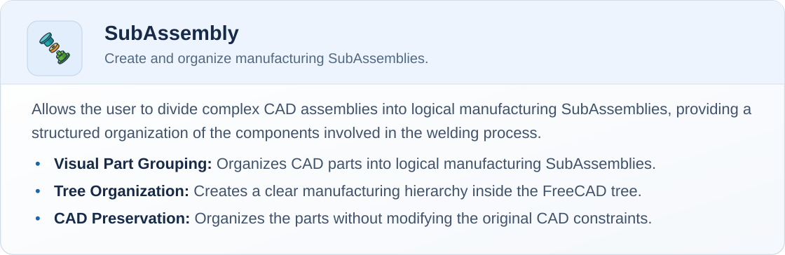</a>

<!-- VIDEO: FreeCAD Plugin - SubAssembly -->

 
<a href="https://youtu.be/YpmVaKtMTJo"><strong>FreeCAD Plugin - SubAssembly</strong></a>

<!-- MATERIALS: SubAssembly -->

<!-- NAVIGATION: Back to top -->
 &nbsp; 
<!-- MATERIALS BUTTON: SubAssembly -->
 &nbsp; 
<!-- NAVIGATION: Back to tool index -->

<!-- ========== BUTTON: Assign Positions ========== -->

<!-- SVG: Assign Positions -->
<a name="readme-image-040" href="#readme-image-040">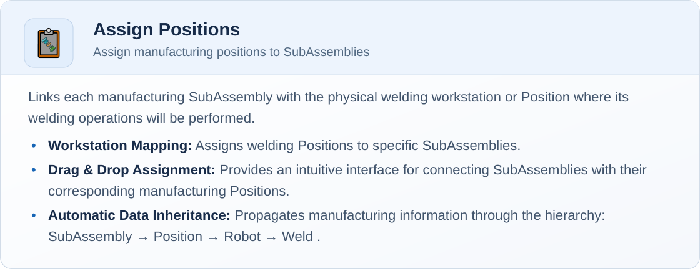</a>

<!-- VIDEO: FreeCAD Plugin - Assign Positions -->

 
<a href="https://youtu.be/fhsHkXg7iRw"><strong>FreeCAD Plugin - Assign Positions</strong></a>

<!-- MATERIALS: Assign Positions -->

<!-- NAVIGATION: Back to top -->
 &nbsp; 
<!-- MATERIALS BUTTON: Assign Positions -->
 &nbsp; 
<!-- NAVIGATION: Back to tool index -->

<!-- ========== BUTTON: Move SubAssembly ========== -->

<!-- SVG: Move SubAssembly -->
<a name="readme-image-042" href="#readme-image-042">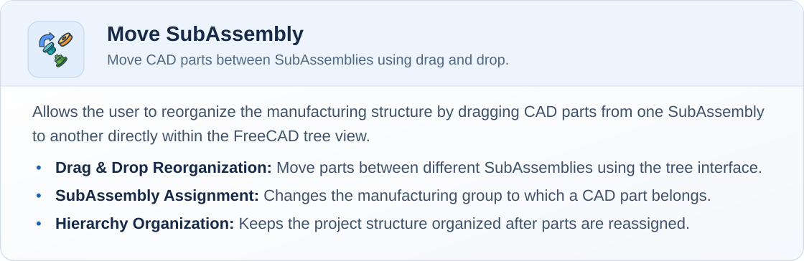</a>

<!-- VIDEO: FreeCAD Plugin - Move SubAssembly -->

 
<a href="https://youtu.be/mTTKCpFWVYk"><strong>FreeCAD Plugin - Move SubAssembly</strong></a>

<!-- MATERIALS: Move SubAssembly -->

<!-- NAVIGATION: Back to top -->
 &nbsp; 
<!-- MATERIALS BUTTON: Move SubAssembly -->
 &nbsp; 
<!-- NAVIGATION: Back to tool index -->

<!-- ========== BUTTON: Move Welds ========== -->

<!-- SVG: Move Welds -->
<a name="readme-image-043" href="#readme-image-043">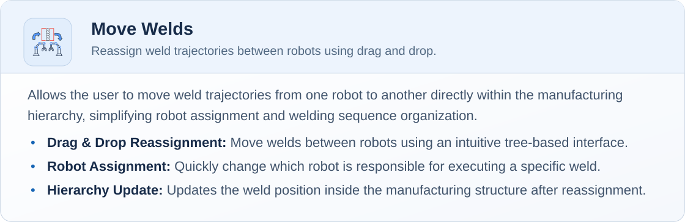</a>

<!-- VIDEO: FreeCAD Plugin - Move Welds -->

 
<a href="https://youtu.be/qzIUtdA1wy0"><strong>FreeCAD Plugin - Move Welds</strong></a>

<!-- MATERIALS: Move Welds -->

<!-- NAVIGATION: Back to top -->
 &nbsp; 
<!-- MATERIALS BUTTON: Move Welds -->
 &nbsp; 
<!-- NAVIGATION: Back to tool index -->

<!-- SECTION: Length -->
<!-- SVG: Length -->

<!-- ========== BUTTON: Weld Length Report ========== -->

<!-- SVG: Weld Length Report -->
<a name="readme-image-046" href="#readme-image-046">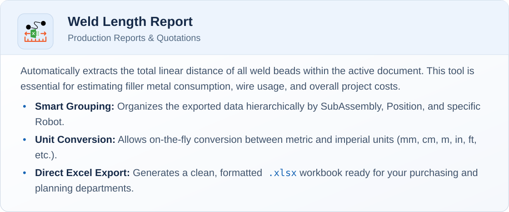</a>

<!-- VIDEO: FreeCAD Plugin - Weld Length Report -->

 
<a href="https://youtu.be/I0hxfyDhnyU"><strong>FreeCAD Plugin - Weld Length Report</strong></a>

<!-- MATERIALS: Weld Length Report -->

<!-- NAVIGATION: Back to top -->
 &nbsp; 
<!-- MATERIALS BUTTON: Weld Length Report -->
 &nbsp; 
<!-- NAVIGATION: Back to tool index -->

<!-- SECTION: Cycle Time -->
<!-- SVG: Cycle Time -->

<!-- ========== BUTTON: Process ========== -->

<!-- SVG: Process -->

<!-- VIDEO: FreeCAD Plugin - Process -->

 
<a href="https://youtu.be/J3FsFntzbZI"><strong>FreeCAD Plugin - Process</strong></a>

<!-- MATERIALS: Process -->

<!-- NAVIGATION: Back to top -->
 &nbsp; 
<!-- MATERIALS BUTTON: Process -->
 &nbsp; 
<!-- NAVIGATION: Back to tool index -->

<!-- ========== BUTTON: Assign Process ========== -->

<!-- SVG: Assign Process -->
<a name="readme-image-050" href="#readme-image-050">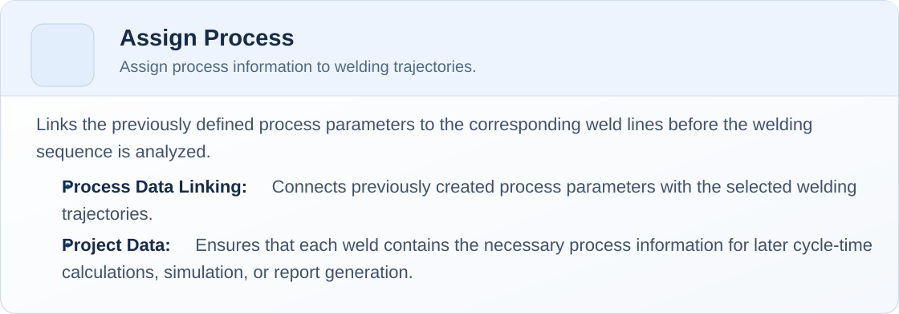</a>

<!-- VIDEO: FreeCAD Plugin - Assign Process -->

 
<a href="https://youtu.be/1zkwhSOLzEg"><strong>FreeCAD Plugin - Assign Process</strong></a>

<!-- MATERIALS: Assign Process -->

<!-- NAVIGATION: Back to top -->
 &nbsp; 
<!-- MATERIALS BUTTON: Assign Process -->
 &nbsp; 
<!-- NAVIGATION: Back to tool index -->

<!-- ========== BUTTON: Welding Parameters ========== -->

<!-- SVG: Welding Parameters -->
<a name="readme-image-052" href="#readme-image-052">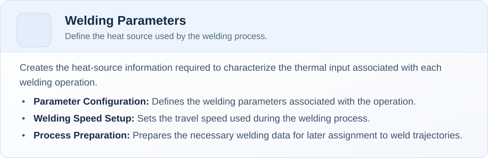</a>

<!-- VIDEO: FreeCAD Plugin - Welding Parameters -->

 
<a href="https://youtu.be/efYxr2li1Y0"><strong>FreeCAD Plugin - Welding Parameters</strong></a>

<!-- MATERIALS: Welding Parameters -->

<!-- NAVIGATION: Back to top -->
 &nbsp; 
<!-- MATERIALS BUTTON: Welding Parameters -->
 &nbsp; 
<!-- NAVIGATION: Back to tool index -->

<!-- ========== BUTTON: Assign Welding Parameters ========== -->

<!-- SVG: Assign Welding Parameters -->
<a name="readme-image-053" href="#readme-image-053">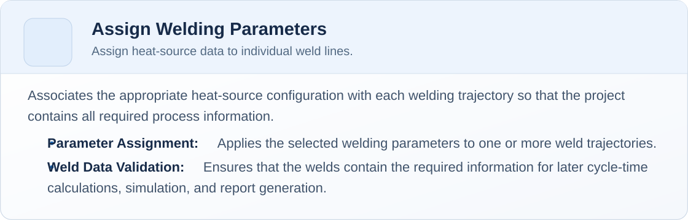</a>

<!-- VIDEO: FreeCAD Plugin - Assign Welding Parameters -->

 
<a href="https://youtu.be/nIkySTHVPmg"><strong>FreeCAD Plugin - Assign Welding Parameters</strong></a>

<!-- MATERIALS: Assign Welding Parameters -->

<!-- NAVIGATION: Back to top -->
 &nbsp; 
<!-- MATERIALS BUTTON: Assign Welding Parameters -->
 &nbsp; 
<!-- NAVIGATION: Back to tool index -->

<!-- ========== BUTTON: Cycle Time ========== -->

<!-- SVG: Cycle Time -->
<a name="readme-image-055" href="#readme-image-055">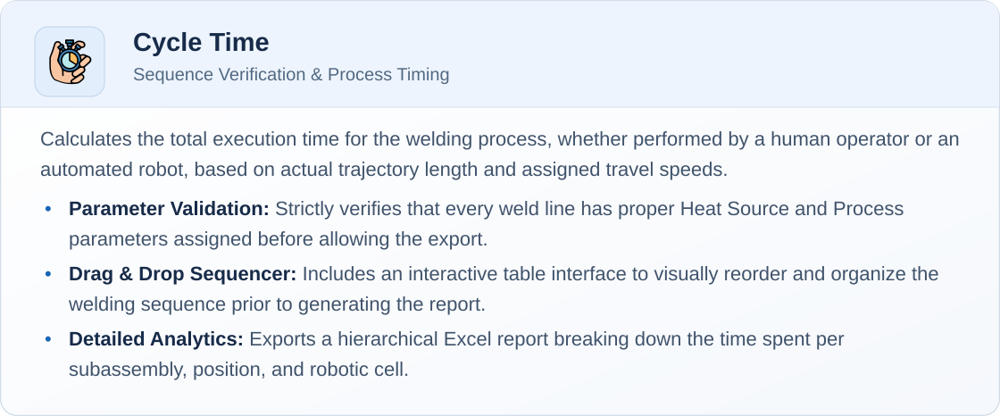</a>

<!-- VIDEO: FreeCAD Plugin - Cycle Time -->

 
<a href="https://youtu.be/YfequjjJOHg"><strong>FreeCAD Plugin - Cycle Time</strong></a>

<!-- MATERIALS: Cycle Time -->

<!-- NAVIGATION: Back to top -->
 &nbsp; 
<!-- MATERIALS BUTTON: Cycle Time -->
 &nbsp; 
<!-- NAVIGATION: Back to tool index -->

<!-- SECTION: Weight -->
<!-- SVG: Weight -->

<!-- ========== BUTTON: Create Materials ========== -->

<!-- SVG: Create Materials -->
<a name="readme-image-058" href="#readme-image-058">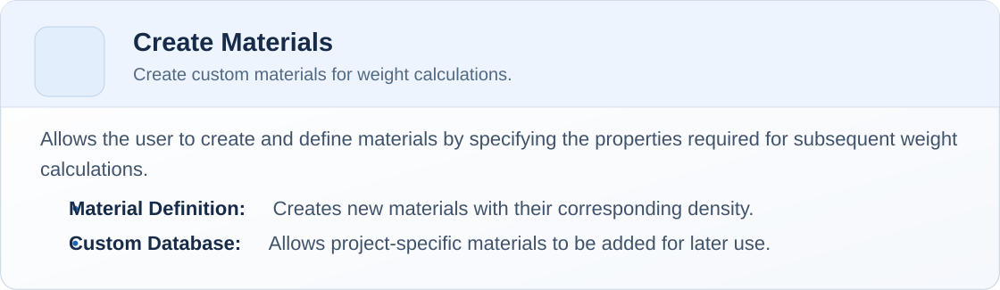</a>

<!-- VIDEO: FreeCAD Plugin - Create Materials -->

 
<a href="https://youtu.be/gqeM4_K-ECU"><strong>FreeCAD Plugin - Create Materials</strong></a>

<!-- MATERIALS: Create Materials -->

<!-- NAVIGATION: Back to top -->
 &nbsp; 
<!-- MATERIALS BUTTON: Create Materials -->
 &nbsp; 
<!-- NAVIGATION: Back to tool index -->

<!-- ========== BUTTON: Assign Materials ========== -->

<!-- SVG: Assign Materials -->

<!-- VIDEO: FreeCAD Plugin - Assign Materials -->

 
<a href="https://youtu.be/p5DxkcvCbJ0"><strong>FreeCAD Plugin - Assign Materials</strong></a>

<!-- MATERIALS: Assign Materials -->

<!-- NAVIGATION: Back to top -->
 &nbsp; 
<!-- MATERIALS BUTTON: Assign Materials -->
 &nbsp; 
<!-- NAVIGATION: Back to tool index -->

<!-- ========== BUTTON: Weight of Welding and Welded Part ========== -->

<!-- SVG: Weight of Welding and Welded Part -->
<a name="readme-image-061" href="#readme-image-061">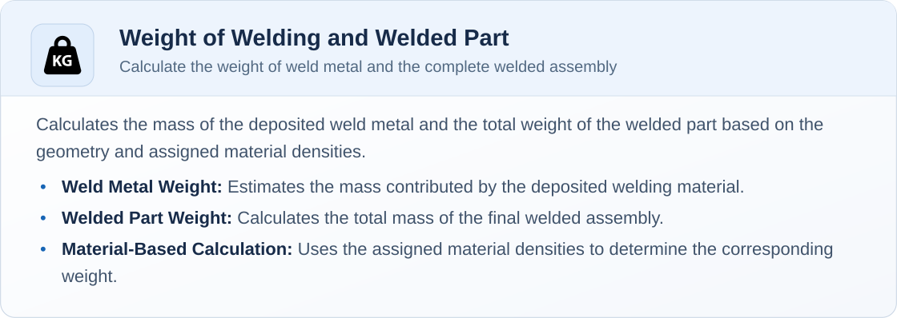</a>

<!-- VIDEO: FreeCAD Plugin - Weight of Welding and Welded Part -->

 
<a href="https://youtu.be/TSO2ZFOpXFQ"><strong>FreeCAD Plugin - Weight of Welding and Welded Part</strong></a>

<!-- MATERIALS: Weight of Welding and Welded Part -->

<!-- NAVIGATION: Back to top -->
 &nbsp; 
<!-- MATERIALS BUTTON: Weight of Welding and Welded Part -->
 &nbsp; 
<!-- NAVIGATION: Back to tool index -->

<!-- SECTION: Welding Sequence AI Advisor -->
<!-- SVG: Welding Sequence AI Advisor -->

<!-- ========== BUTTON: Export STL ========== -->

<!-- SVG: Export STL -->

<!-- VIDEO: FreeCAD Plugin - Export STL -->

 
<a href="https://youtu.be/8J90-dEdBuw"><strong>FreeCAD Plugin - Export STL</strong></a>

<!-- MATERIALS: Export STL -->

<!-- NAVIGATION: Back to top -->
 &nbsp; 
<!-- MATERIALS BUTTON: Export STL -->
 &nbsp; 
<!-- NAVIGATION: Back to tool index -->

<!-- ========== BUTTON: Export As DK Project ========== -->

<!-- SVG: Export As DK Project -->

<!-- VIDEO: FreeCAD Plugin - Export As .DK Project -->

 
<a href="https://youtu.be/tFdOI0CLJ2E"><strong>FreeCAD Plugin - Export As .DK Project</strong></a>

<!-- VIDEO: FreeCAD Plugin - Visualizer sequence -->

 
<a href="https://youtu.be/PHD1q_jOWfI"><strong>FreeCAD Plugin - Visualizer sequence</strong></a>

<!-- MATERIALS: Export As DK Project -->

<!-- NAVIGATION: Back to top -->
 &nbsp; 
<!-- MATERIALS BUTTON: Export As DK Project -->
 &nbsp; 
<!-- NAVIGATION: Back to tool index -->

<!-- SECTION: Sequence and Process Visualization -->
<!-- SVG: Sequence and Process Visualization -->

<!-- ========== BUTTON: Assign Sequence ========== -->

<!-- SVG: Assign Sequence -->

<!-- VIDEO: FreeCAD Plugin - Assign Sequence -->

 
<a href="https://youtu.be/sbbIHfgqX2g"><strong>FreeCAD Plugin - Assign Sequence</strong></a>

<!-- MATERIALS: Assign Sequence -->

<!-- NAVIGATION: Back to top -->
 &nbsp; 
<!-- MATERIALS BUTTON: Assign Sequence -->
 &nbsp; 
<!-- NAVIGATION: Back to tool index -->

<!-- ========== BUTTON: Weld Simulation ========== -->

<!-- SVG: Weld Simulation -->

<!-- VIDEO: FreeCAD Plugin - Weld Simulation -->

 
<a href="https://youtu.be/IG-jzgcbnaU"><strong>FreeCAD Plugin - Weld Simulation</strong></a>

<!-- MATERIALS: Weld Simulation -->

<!-- NAVIGATION: Back to top -->
 &nbsp; 
<!-- MATERIALS BUTTON: Weld Simulation -->
 &nbsp; 
<!-- NAVIGATION: Back to tool index -->

<!-- ========== BUTTON: Show Weld Sphere ========== -->

<!-- SVG: Show Weld Sphere -->
<a name="readme-image-073" href="#readme-image-073">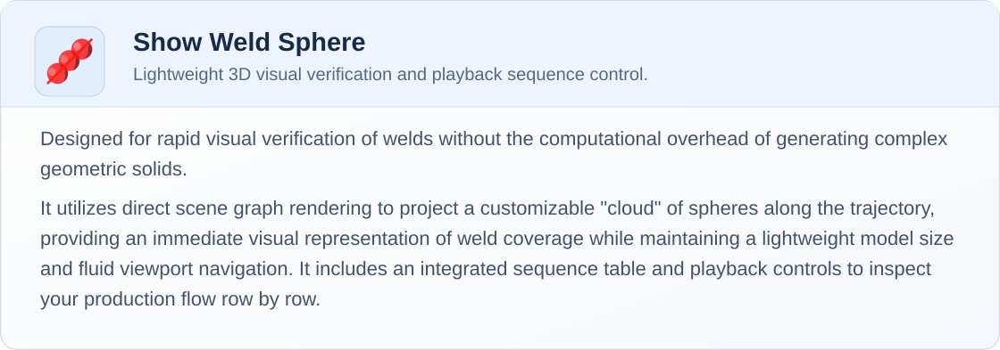</a>

<!-- VIDEO: FreeCAD Plugin - Show Weld Sphere -->

 
<a href="https://youtu.be/WYtFumW3uMA"><strong>FreeCAD Plugin - Show Weld Sphere</strong></a>

<!-- MATERIALS: Show Weld Sphere -->

<!-- NAVIGATION: Back to top -->
 &nbsp; 
<!-- MATERIALS BUTTON: Show Weld Sphere -->
 &nbsp; 
<!-- NAVIGATION: Back to tool index -->

<!-- ========== BUTTON: Visualizer ========== -->

<!-- SVG: Visualizer -->

<!-- VIDEO: FreeCAD Plugin - Visualizer -->

 
<a href="https://youtu.be/Trsfr1fTupg"><strong>FreeCAD Plugin - Visualizer</strong></a>

<!-- MATERIALS: Visualizer -->

<!-- NAVIGATION: Back to top -->
 &nbsp; 
<!-- MATERIALS BUTTON: Visualizer -->
 &nbsp; 
<!-- NAVIGATION: Back to tool index -->

 

<!-- SECTION: 3-2-1 Datum Based Alignment & Tools -->
<!-- SVG: 3-2-1 Datum Based Alignment & Tools -->

<!-- ========== BUTTON: Toggle Visibility Recursive ========== -->

<!-- SVG: Toggle Visibility Recursive -->
<a name="readme-image-078" href="#readme-image-078">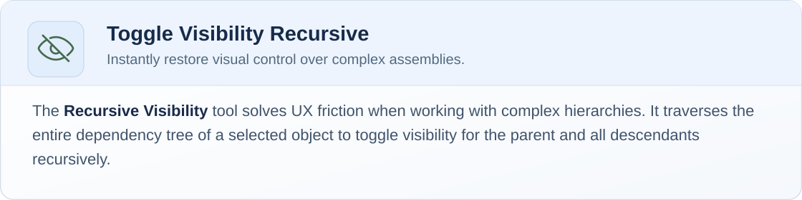</a>

<!-- VIDEO: FreeCAD Plugin - Toggle Visibility Recursive -->

 
<a href="https://youtu.be/98fj0JjP6xo"><strong>FreeCAD Plugin - Toggle Visibility Recursive</strong></a>

<!-- MATERIALS: Toggle Visibility Recursive -->

<!-- NAVIGATION: Back to top -->
 &nbsp; 
<!-- MATERIALS BUTTON: Toggle Visibility Recursive -->
 &nbsp; 
<!-- NAVIGATION: Back to tool index -->

<!-- ========== BUTTON: Create Center Point ========== -->

<!-- SVG: Create Center Point -->

<!-- VIDEO: FreeCAD Plugin - Create Center Point -->

 
<a href="https://youtu.be/9Kda5vfYem0"><strong>FreeCAD Plugin - Create Center Point</strong></a>

<!-- MATERIALS: Create Center Point -->

<!-- NAVIGATION: Back to top -->
 &nbsp; 
<!-- MATERIALS BUTTON: Create Center Point -->
 &nbsp; 
<!-- NAVIGATION: Back to tool index -->

<!-- ========== BUTTON: Create Sphere at Origin ========== -->

<!-- SVG: Create Sphere at Origin -->

<!-- VIDEO: FreeCAD Plugin - Create Sphere at Origin -->

 
<a href="https://youtu.be/lA9C68IScxQ"><strong>FreeCAD Plugin - Create Sphere at Origin</strong></a>

<!-- MATERIALS: Create Sphere at Origin -->

<!-- NAVIGATION: Back to top -->
 &nbsp; 
<!-- MATERIALS BUTTON: Create Sphere at Origin -->
 &nbsp; 
<!-- NAVIGATION: Back to tool index -->

<!-- SECTION: category 3-2-1 Datum Based Alignment -->
<!-- SVG: category 3-2-1 Datum Based Alignment -->

<!-- ========== BUTTON: Datum A ========== -->

<!-- SVG: Datum A -->

<!-- ========== BUTTON: Datum B ========== -->

<!-- SVG: Datum B -->

<!-- ========== BUTTON: Datum C ========== -->

<!-- SVG: Datum C -->

<!-- ========== BUTTON: 3-2-1 Datum-Based Alignment ========== -->

<!-- MATERIALS: 3-2-1 Datum-Based Alignment -->

<!-- NAVIGATION: Back to top -->
 &nbsp; 
<!-- MATERIALS BUTTON: 3-2-1 Datum-Based Alignment -->
 &nbsp; 
<!-- NAVIGATION: Back to tool index -->

<!-- ========== BUTTON: Move Model To Origin ========== -->

<!-- SVG: Move Model To Origin -->

<!-- VIDEO: FreeCAD Plugin - 3-2-1 Datum Based Alignment -->

 
<a href="https://youtu.be/Zr0ybqXDSgg"><strong>FreeCAD Plugin - 3-2-1 Datum Based Alignment</strong></a>

<!-- MATERIALS: Move Model To Origin -->

<!-- NAVIGATION: Back to top -->
 &nbsp; 
<!-- MATERIALS BUTTON: Move Model To Origin -->
 &nbsp; 
<!-- NAVIGATION: Back to tool index -->

<!-- SECTION: category tools -->
<!-- SVG: category tools -->

<!-- ========== BUTTON: Reset Position ========== -->

<!-- SVG: Reset Position -->

<!-- VIDEO: FreeCAD Plugin - Reset Position -->

 
<a href="https://youtu.be/CXzQ7datvRk"><strong>FreeCAD Plugin - Reset Position</strong></a>

<!-- MATERIALS: Reset Position -->

<!-- NAVIGATION: Back to top -->
 &nbsp; 
<!-- MATERIALS BUTTON: Reset Position -->
 &nbsp; 
<!-- NAVIGATION: Back to tool index -->

<!-- ========== BUTTON: Show Welding Widget ========== -->

<!-- SVG: Show Welding Widget -->

<!-- VIDEO: FreeCAD Plugin - Show Welding Widget -->

 
<a href="https://youtu.be/SjJHcsazPro"><strong>FreeCAD Plugin - Show Welding Widget</strong></a>

<!-- MATERIALS: Show Welding Widget -->

<!-- NAVIGATION: Back to top -->
 &nbsp; 
<!-- MATERIALS BUTTON: Show Welding Widget -->
 &nbsp; 
<!-- NAVIGATION: Back to tool index -->

<!-- ========== BUTTON: Launch Find Data Panel ========== -->

<!-- SVG: Launch Find Data Panel -->
<a name="readme-image-095" href="#readme-image-095">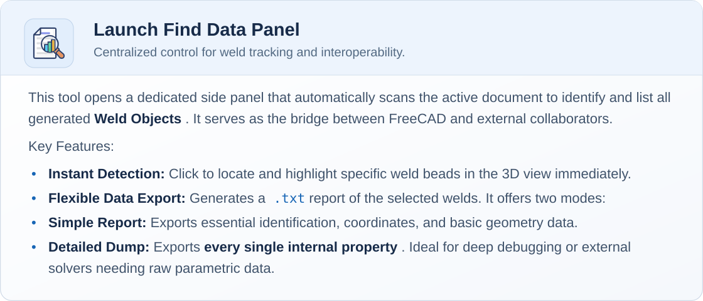</a>

<!-- VIDEO: FreeCAD Plugin - Launch Find Data Panel -->

 
<a href="https://youtu.be/0TlnWFqXXWM"><strong>FreeCAD Plugin - Launch Find Data Panel</strong></a>

<!-- MATERIALS: Launch Find Data Panel -->

<!-- NAVIGATION: Back to top -->
 &nbsp; 
<!-- MATERIALS BUTTON: Launch Find Data Panel -->
 &nbsp; 
<!-- NAVIGATION: Back to tool index -->

<!-- ========== BUTTON: Focus Object ========== -->

<!-- SVG: Focus Object -->
<a name="readme-image-097" href="#readme-image-097">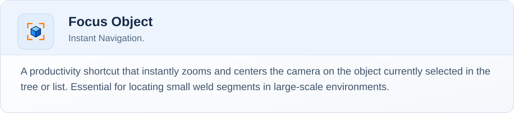</a>

<!-- VIDEO: FreeCAD Plugin - Focus Object -->

 
<a href="https://youtu.be/KZhHsQ0q4Go"><strong>FreeCAD Plugin - Focus Object</strong></a>

<!-- MATERIALS: Focus Object -->

<!-- NAVIGATION: Back to top -->
 &nbsp; 
<!-- MATERIALS BUTTON: Focus Object -->
 &nbsp; 
<!-- NAVIGATION: Back to tool index -->

<!-- ========== BUTTON: Move Weld Lines ========== -->

<!-- SVG: Move Weld Lines -->

<!-- VIDEO: FreeCAD Plugin - Move Weld Lines -->

 
<a href="https://youtu.be/I7i4gXoQ7sU"><strong>FreeCAD Plugin - Move Weld Lines</strong></a>

<!-- MATERIALS: Move Weld Lines -->

<!-- NAVIGATION: Back to top -->
 &nbsp; 
<!-- MATERIALS BUTTON: Move Weld Lines -->
 &nbsp; 
<!-- NAVIGATION: Back to tool index -->

<!-- ========== BUTTON: Discretize ========== -->

<!-- SVG: Discretize -->
<a name="readme-image-101" href="#readme-image-101">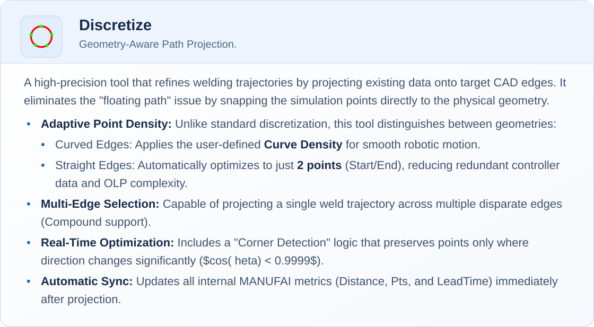</a>

<!-- VIDEO: FreeCAD Plugin - Discretize -->

 
<a href="https://youtu.be/PjOlYZdEWsc"><strong>FreeCAD Plugin - Discretize</strong></a>

<!-- MATERIALS: Discretize -->

<!-- NAVIGATION: Back to top -->
 &nbsp; 
<!-- MATERIALS BUTTON: Discretize -->
 &nbsp; 
<!-- NAVIGATION: Back to tool index -->

 

<!-- SECTION: C3P – WdCurve Tools -->
<!-- SVG: C3P – WdCurve Tools -->

<!-- ========== BUTTON: Line Weld Table ========== -->

<!-- SVG: Line Weld Table -->
<a name="readme-image-104" href="#readme-image-104">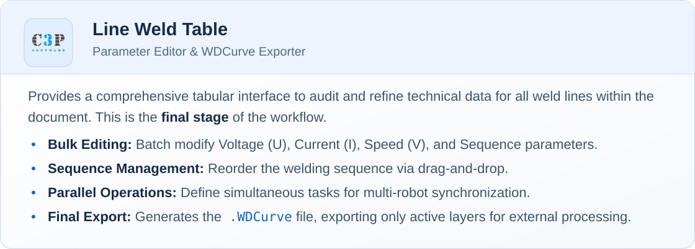</a>

<!-- VIDEO: FreeCAD Plugin - Line Weld Table -->

 
<a href="https://youtu.be/ulF9SZYRMbs"><strong>FreeCAD Plugin - Line Weld Table</strong></a>

<!-- MATERIALS: Line Weld Table -->

<!-- NAVIGATION: Back to top -->
 &nbsp; 
<!-- MATERIALS BUTTON: Line Weld Table -->
 &nbsp; 
<!-- NAVIGATION: Back to tool index -->

<!-- ========== BUTTON: Show Names ========== -->

<!-- SVG: Show Names -->

<!-- VIDEO: FreeCAD Plugin - Show Names -->

 
<a href="https://youtu.be/rHTBzO_KlUM"><strong>FreeCAD Plugin - Show Names</strong></a>

<!-- MATERIALS: Show Names -->

<!-- NAVIGATION: Back to top -->
 &nbsp; 
<!-- MATERIALS BUTTON: Show Names -->
 &nbsp; 
<!-- NAVIGATION: Back to tool index -->

<!-- ========== BUTTON: Selection Mode (X-Ray & Filter) ========== -->

<!-- SVG: Selection Mode (X-Ray & Filter) -->
<a name="readme-image-106" href="#readme-image-106">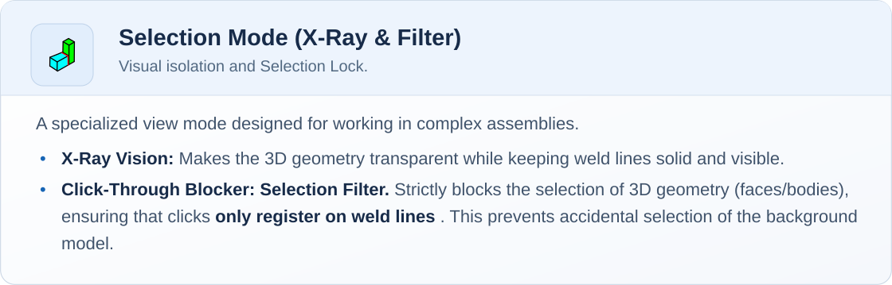</a>

<!-- VIDEO: FreeCAD Plugin - Selection Mode (X-Ray & Filter) -->

 
<a href="https://youtu.be/OYs8zfXLmLg"><strong>FreeCAD Plugin - Selection Mode (X-Ray &amp; Filter)</strong></a>

<!-- MATERIALS: Selection Mode (X-Ray & Filter) -->

<!-- NAVIGATION: Back to top -->
 &nbsp; 
<!-- MATERIALS BUTTON: Selection Mode (X-Ray & Filter) -->
 &nbsp; 
<!-- NAVIGATION: Back to tool index -->

 

<!-- SECTION: RoboDK & Process Automation -->
<!-- SVG: RoboDK & Process Automation -->

<!-- ========== BUTTON: Export To .rdk Project ========== -->

<!-- SVG: Export To .rdk Project -->
<a name="readme-image-109" href="#readme-image-109">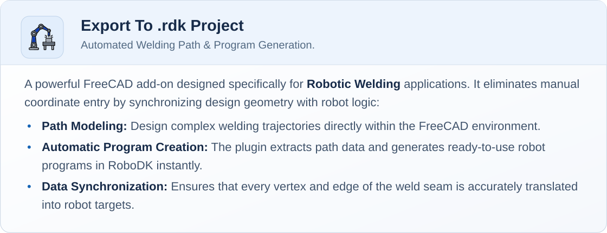</a>

<!-- VIDEO: FreeCAD Plugin - Export To .rdk Project -->

 
<a href="https://youtu.be/OEVVUK7duXI"><strong>FreeCAD Plugin - Export To .rdk Project</strong></a>

<!-- VIDEO: FreeCAD Plugin - Robotic Cell Modeling for automatic transfer of weld data -->

 
<a href="https://youtu.be/UfwyzfO2fFI"><strong>FreeCAD Plugin - Robotic Cell Modeling for automatic transfer of weld data</strong></a>

<!-- VIDEO: Weld Path to Robot Program - FreeCAD Plugin Demo -->

 
<a href="https://youtu.be/_DmwPQABFhU"><strong>Weld Path to Robot Program - FreeCAD Plugin Demo</strong></a>

<!-- MATERIALS: Export To .rdk Project -->

<!-- NAVIGATION: Back to top -->
 &nbsp; 
<!-- MATERIALS BUTTON: Export To .rdk Project -->
 &nbsp; 
<!-- NAVIGATION: Back to tool index -->

<!-- ========== BUTTON: Export Full ========== -->

<!-- SVG: Export Full -->
<a name="readme-image-111" href="#readme-image-111">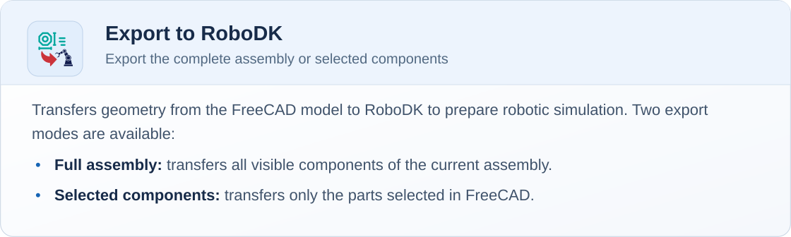</a>

<!-- VIDEO: FreeCAD Plugin - Export to RoboDK -->

 
<a href="https://youtu.be/guC-Ew76XLk"><strong>FreeCAD Plugin - Export to RoboDK</strong></a>

<!-- MATERIALS: Export Full -->

<!-- NAVIGATION: Back to top -->
 &nbsp; 
<!-- MATERIALS BUTTON: Export Full -->
 &nbsp; 
<!-- NAVIGATION: Back to tool index -->

<!-- ========== BUTTON: Glue Manager ========== -->

<!-- SVG: Glue Manager -->

<!-- VIDEO: FreeCAD Plugin - Glue Manager -->

 
<a href="https://youtu.be/tAGyyp9iRvI"><strong>FreeCAD Plugin - Glue Manager</strong></a>

<!-- MATERIALS: Glue Manager -->

<!-- NAVIGATION: Back to top -->
 &nbsp; 
<!-- MATERIALS BUTTON: Glue Manager -->
 &nbsp; 
<!-- NAVIGATION: Back to tool index -->

<!-- ========== BUTTON: Drilling Manager ========== -->

<!-- SVG: Drilling Manager -->
<a name="readme-image-115" href="#readme-image-115">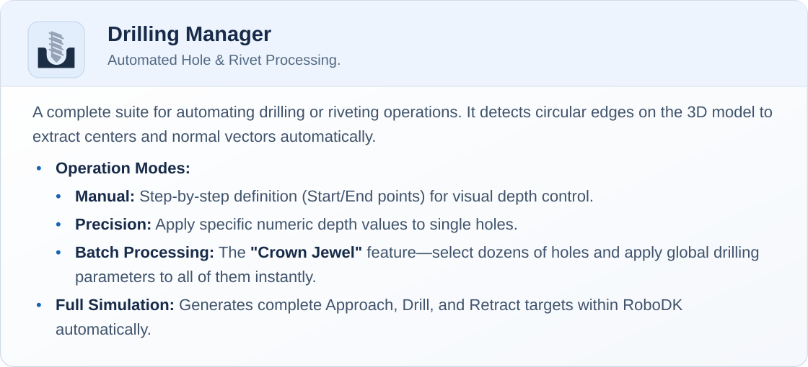</a>

<!-- VIDEO: FreeCAD Plugin - Drilling Manager -->

 
<a href="https://youtu.be/tdOwb-ST3sI"><strong>FreeCAD Plugin - Drilling Manager</strong></a>

<!-- MATERIALS: Drilling Manager -->

<!-- NAVIGATION: Back to top -->
 &nbsp; 
<!-- MATERIALS BUTTON: Drilling Manager -->
 &nbsp; 
<!-- NAVIGATION: Back to tool index -->

 

